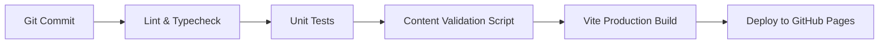

# RENCANA PRODUK & ARSITEKTUR TEKNIS (PRODUCT PLAN & TECH SPEC)

Dokumen ini mendefinisikan arsitektur aplikasi, skema data TypeScript, pemisahan state SRS, antarmuka layar, manajemen risiko, rencana pengujian/CI, serta aturan validasi konten otomatis untuk aplikasi **Nihongo**.

---

## 1. Arsitektur Teknis & Prinsip Rekayasa

### 1.1 Stack Teknologi
* **Arsitektur:** Static Single Page Application (SPA), zero-backend, dapat di-deploy langsung ke GitHub Pages atau static hosting.
* **Framework & Bahasa:** **Vite + React + TypeScript**.
* **Styling:** Vanilla CSS murni dengan variabel warna (*Design Tokens*). Estetika "buku catatan": kanvas navy, lembar kertas krem, aksen amber, judul serif. Kontras token sudah dinaikkan, tetapi belum diuji dengan axe atau Lighthouse — lihat `docs/qa-lesson-01.md` §5.
* **Tipografi & Aksara Jepang:**
  * Menghindari unduhan bundel font berat yang menguras kuota mobile data pembelajar.
  * Menggunakan *system font stack* tanpa permintaan jaringan:
    * Latin display: `"Iowan Old Style", "Palatino Linotype", Palatino, Georgia, serif`
    * Jepang: `"Yu Mincho", "Hiragino Mincho ProN", "Noto Serif JP", serif`
    * Antarmuka: `-apple-system, BlinkMacSystemFont, "Segoe UI", Roboto, sans-serif`
  * Format furigana menggunakan standar elemen semantik HTML5 modern:
    `<ruby>日本語<rt>にほんご</rt></ruby>` (tanpa tag `<rb>` yang sudah usang).
* **Penyimpanan State:** `localStorage` lokal pada peramban pembelajar.
  * Menyimpan progres belajar per pelajaran, antrean pengulangan SRS, log kesalahan (*Error Notebook*), dan preferensi.
  * Dilengkapi fungsi **Export & Import JSON** untuk pencadangan mandiri tanpa kewajiban mendaftar akun atau login.

### 1.2 Spaced Repetition System (SRS)
* **Model Jadwal:** Spaced practice dengan jadwal interval tetap yang dapat disesuaikan (*fixed interval, tunable*: interval default hari ke-1, 3, 7, 14, 30).
* **Pemisahan Konten & State:** Konten kartu ulasan statis (`ReviewCard`) dipisahkan secara tegas dari state progres pengguna (`SrsState`).
* **Tipe Kartu:** Mencakup 5 variasi: `"vocab" | "grammar" | "particle" | "listening" | "output"`. Mengutamakan kartu produksi/aktif (recall makna ke Jepang, rumpang partikel, susun kalimat).
* **Batas Antrean:** Jika backlog ulasan menumpuk > 50 kartu, pembelajar diarahkan untuk membersihkan antrean review terlebih dahulu sebelum membuka pelajaran baru.

### 1.3 Mekanisme Audio (Kepatuhan Mode A Link-Only)
* Tombol audio pada antarmuka berfungsi membuka file audio MP3 resmi NHK di tab baru atau menuju pemutar resmi di web NHK. **Tidak meng-embed pemutar audio lokal atau menyimpan file MP3 di server/repo.**
* **Penyelesaian Durasi MP3 Siaran (10 menit vs 3–4 menit sesi):**
  1. Aplikasi menyertakan **Petunjuk Timestamp Percakapan** (pada Pelajaran 1: dialog Anna–Sakura berada di menit **01:22 – 01:34**, buffer perkiraan **01:20 – 01:35**).
  2. Menyediakan tombol pintas langsung menuju **Pemutar Kalimat Resmi NHK** untuk mendengarkan kalimat dialog per kalimat secara terisolasi.

### 1.4 Halaman Kana, Bantuan Suara, dan Penemuan Tautan Resmi
* **Halaman Kana:** 46 kana dasar + 25 kana bersuara, tersedia dalam hiragana
  dan katakana lewat dua tab. Satu tombol per kana. Satu kana = satu mora,
  sehingga pemutaran per aksara dapat dipertanggungjawabkan. Bila perangkat
  tidak punya voice `ja-JP`, ketukan tidak berbunyi dan halaman menjelaskan
  sebabnya, bukan diam saja.
* **Batas bantuan suara:** `speechSynthesis` perangkat hanya dipakai untuk
  kana tunggal dan kata tunggal pada daftar kosakata. Tidak untuk dialog atau
  kalimat. Tombol dinonaktifkan bila voice `ja-JP` tidak tersedia, dan status
  voice ditampilkan di modal setelan.
* **Penemuan tautan resmi:** tautan NHK tidak boleh berupa teks kecil abu-abu.
  Setiap pelajaran memakai komponen `SourceLinks` berisi label "Sumber resmi",
  penjelasan satu baris tentang NHK WORLD, dua tombol besar (audio dan naskah),
  tombol salin menit dialog, serta panduan tiga langkah pada tahap Dengar.
  Peta pelajaran juga menampilkan "Audio NHK" dan "Naskah" sebagai aksi kartu.

---

## 2. Model Data & Skema TypeScript

```ts
export type RubySegment = {
  text: string;
  reading?: string; // furigana pembacaan kana jika teks berupa kanji
};

export type LanguageString = {
  jp: string;           // Teks kanji/kana asli: e.g. "私はアンナです"
  kana: string;         // Bacaan kana lengkap: e.g. "わたしはアンナです"
  romaji: string;       // Transliterasi Hepburn: e.g. "Watashi wa Anna desu"
  id: string;           // Terjemahan orisinal bahasa Indonesia
  rubySegments?: RubySegment[]; // Segmentasi furigana presisi
  rubyHtml?: string;    // String HTML ruby yang sudah tervalidasi
};

export type Question = {
  id: string;
  question: string;
  options: string[];
  correctIndex: number;
  explanation: string;
  sourceRef: string;
  qaStatus: "draft" | "machine_checked" | "human_reviewed" | "published";
};

export type VocabItem = {
  id: string;
  kanji?: string;
  kana: string;
  romaji: string;
  idMeaning: string;
  contextSentence?: LanguageString;
  sourceRef: string;    // e.g. "NHK L01 line 2" atau "original"
  qaStatus: "draft" | "machine_checked" | "human_reviewed" | "published";
};

export type GrammarPoint = {
  id: string;
  title: string;           // e.g. "A wa B desu"
  pattern: string;         // e.g. "[Subjek] wa [Predikat] desu"
  explanationId: string;   // Penjelasan orisinal bahasa Indonesia
  contrastNote: string;    // Catatan kontras pola pikir dengan bahasa Indonesia
  examples: LanguageString[]; // Contoh kalimat orisinal
  role: "active_target" | "recognition_reference";
  sourceRef: string;
  qaStatus: "draft" | "machine_checked" | "human_reviewed" | "published";
};

export type Exercise = {
  id: string;
  type: "cloze_particle" | "sentence_order" | "dictation" | "audio_meaning" | "meaning_to_jp" | "grammar_transform";
  prompt: string;
  options?: string[];
  correctAnswer: string | string[];
  explanation: string;     // Penjelasan aturan jika salah
  sourceRef: string;
  qaStatus: "draft" | "machine_checked" | "human_reviewed" | "published";
};

export type OutputTask = {
  type: "speaking" | "writing";
  scenarioPrompt: string;
  instructions: string[];
  modelAnswer: LanguageString;
  selfCheckList: string[]; // 3-4 kriteria evaluasi mandiri
  sourceRef: string;
  qaStatus: "draft" | "machine_checked" | "human_reviewed" | "published";
};

// Konten statis kartu ulasan
export type ReviewCard = {
  id: string;
  lessonId: string;
  front: string;
  back: string;
  type: "vocab" | "grammar" | "particle" | "listening" | "output";
  audioRef?: string;       // Tautan resmi untuk rujukan dengar (Mode A)
  sourceRef: string;
  qaStatus: "draft" | "machine_checked" | "human_reviewed" | "published";
};

// State dinamis SRS pengguna (disimpan di localStorage)
export type SrsState = {
  cardId: string;
  intervalDays: number;
  nextReviewDate: string;  // Format ISO Date
  repetitionCount: number;
  easeFactor?: number;
  lastReviewedDate?: string;
  history?: { date: string; rating: "again" | "hard" | "good" | "easy" }[];
};

export type Lesson = {
  id: string;                  // e.g. "L01"
  order: number;               // 1..48
  title: LanguageString;
  pdfPage: number;             // Nomor halaman PDF sumber (PDF p. 6)
  printedPage: number;         // Nomor halaman cetak sumber (Cetak p. 5)
  situationCategories: string[]; // Multi-label dari TOC resmi
  productArcId: string;        // e.g. "arc-1"
  officialUrls: {
    lessonPage: string;        // URL resmi pelajaran NHK
    audioMp3: string;          // URL resmi file MP3 NHK
    audioTimestamp?: { start: string; end: string; label: string }; // e.g. "01:22" - "01:34"
  };
  canDo: string[];             // Pernyataan capaian fungsional
  grammarPoints: GrammarPoint[];
  vocabulary: VocabItem[];     // Batas: 5–8 kosakata aktif
  listening: {
    gistQuestions: Question[];   // Pertanyaan pemahaman esensi global
    detailQuestions: Question[]; // Pertanyaan pemahaman detail percakapan
  };
  noticeShortQuotes: {
    targetSentence: LanguageString;
    attribution: string;
  }[];                         // Maksimal 1–2 kalimat kutipan teratribusi
  exercises: Exercise[];       // Batas: 4–8 butir latihan aktif
  outputTask: OutputTask;
  reviewCards: ReviewCard[];   // Batas: 8–12 kartu ulasan
  qa: {
    status: "draft" | "machine_checked" | "human_reviewed" | "published";
    reviewedBy: string;        // Nama reviewer atau "TBD"
    verifiedDate?: string;
  };
};
```

---

## 3. Tabel Manajemen Risiko & Mitigasi (Risk Table)

| Kategori Risiko | Deskripsi Risiko | Dampak | Strategi Mitigasi Terverifikasi |
| :--- | :--- | :---: | :--- |
| **Hak Cipta (Copyright)** | Gugatan atau keluhan atas redistribusi aset berhak cipta milik NHK. | Tinggi | **Menerapkan Zero-Asset Storage:** Berkas PDF, MP3 siaran, dan gambar komik NHK dilarang di-commit/di-host. Audio diakses via link-only ke tab resmi; kutipan dibatasi 1–2 kalimat teratribusi dengan klausul siap dihapus jika diminta. |
| **Kualitas & Akurasi Teks** | Kesalahan partikel (misal は dilafalkan ha/wa), furigana meleset, atau salah identifikasi kosakata. | Tinggi | Seluruh kalimat bahasa Jepang diperiksa manual terhadap naskah visual PDF asli. Menggunakan segmentasi ruby presisi; status QA transparan (`TBD` jika belum direview penutur mahir). |
| **Halusinasi AI** | Konten etimologi kanji buatan, stroke order keliru, atau intonasi nada fiktif. | Sedang | **Aturan Anti-Slop Mutlak:** Melarang pembuatan diagram stroke order atau pitch-accent otomatis dari AI; hanya menyajikan fakta tata bahasa yang diverifikasi sumber rujukan. |
| **Kelelahan Kognitif Pembelajar** | Pembelajar merasa kewalahan akibat pelajaran yang memuat terlalu banyak poin sekaligus. | Sedang | Membatasi kosakata aktif 5–8 kata, membagi materi 3-poin sumber menjadi 2 target aktif + 1 referensi, serta membatasi progres jika antrean review > 50 kartu. |
| **Performa Akses Seluler** | Halaman lambat dimuat pada jaringan mobile data Indonesia. | Rendah | Menggunakan Vite SPA statis ringan, CSS murni tanpa framework berat, serta *system font stack* bebas unduhan berkas font eksternal berukuran besar. |

---

## 4. Rencana Pengujian & CI (Test & CI Plan)

Setiap perubahan kode dan pembaruan konten pada repositori wajib melewati gerbang integrasi berkelanjutan (*Continuous Integration*):



### 4.1 Lingkup Pengujian Otomatis
1. **Pemeriksaan Tipe & Linting:** `npm run lint` & `tsc --noEmit` wajib lulus tanpa peringatan atau error tipe.
2. **Unit Testing (Vitest):**
   * Pengujian logika penjadwalan SRS (perhitungan interval hari, pembaruan antrean).
   * Normalisasi jawaban input teks pembelajar (toleransi huruf besar/kecil, spasi ganda, variasi kana/romaji).
   * Pengujian integritas ekspor/impor JSON *round-trip* pada `localStorage`.
3. **Skrip Validasi Konten Otomatis (`scripts/validate-content.ts`):**
   * **Batas Kosakata:** Memastikan setiap pelajaran memiliki minimal 5 dan maksimal 8 kosakata aktif (`5 <= vocab.length <= 8`).
   * **Batas Latihan:** Memastikan setiap pelajaran memiliki 4 s.d. 8 butir latihan aktif (`4 <= exercises.length <= 8`).
   * **Batas Kartu SRS:** Memastikan setiap pelajaran memiliki 8 s.d. 12 kartu ulasan (`8 <= reviewCards.length <= 12`).
   * **Ketersediaan Capaian:** Memastikan setiap pelajaran memiliki minimal satu *Can-Do Statement*.
   * **Kepatuhan Atribusi & QA:** Memastikan setiap kosakata, contoh kalimat, latihan, dan kartu memiliki `sourceRef` dan `qaStatus`.
   * **Validasi Tautan Eksternal:** Menguji kesahihan sintaks dan status URL resmi pelajaran NHK dan URL file MP3.
   * **Pencegahan Klaim Ilegal:** Memastikan tidak ada frasa terlarang seperti "Lulus JLPT N3/N4" atau "Materi Resmi NHK".

---

## 5. Rencana Pelaksanaan MVP 5 Pelajaran (Gate 3)

Setelah Gate 2 (Slice Vertikal Pelajaran 1 secara *end-to-end*) selesai dibangun dan disetujui, tahap Gate 3 akan merealisasikan 5 pelajaran pertama dari **Arc 1**:
1. **Pelajaran 1 (PDF p. 6 / Cetak p. 5):** *WATASHI WA ANNA DESU* (Perkenalan diri & partikel topik WA).
2. **Pelajaran 2 (PDF p. 7 / Cetak p. 6):** *KORE WA NAN DESU KA* (Kata tunjuk KORE/SORE, partikel tanya KA, & partikel kepemilikan NO).
3. **Pelajaran 3 (PDF p. 8 / Cetak p. 7):** *TOIRE WA DOKO DESU KA* (Tanya lokasi fasilitas & penunjuk tempat KOKO/SOKO/ASOKO).
4. **Pelajaran 4 (PDF p. 9 / Cetak p. 8):** *TADAIMA* (Salam kepulangan asrama & negasi sopan DEWA ARIMASEN).
5. **Pelajaran 5 (PDF p. 10 / Cetak p. 9):** *SORE WA WATASHI NO TAKARAMONO DESU* (Objek partikel O & pengenalan verba ~MASU).
